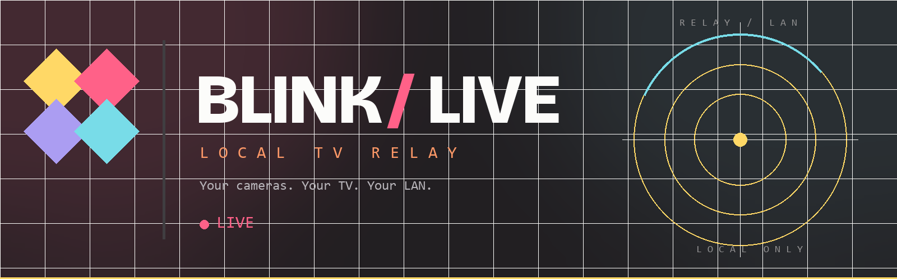
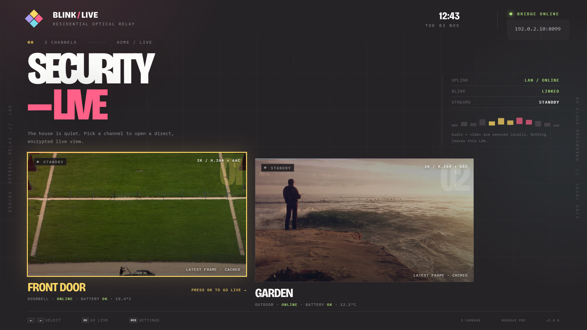
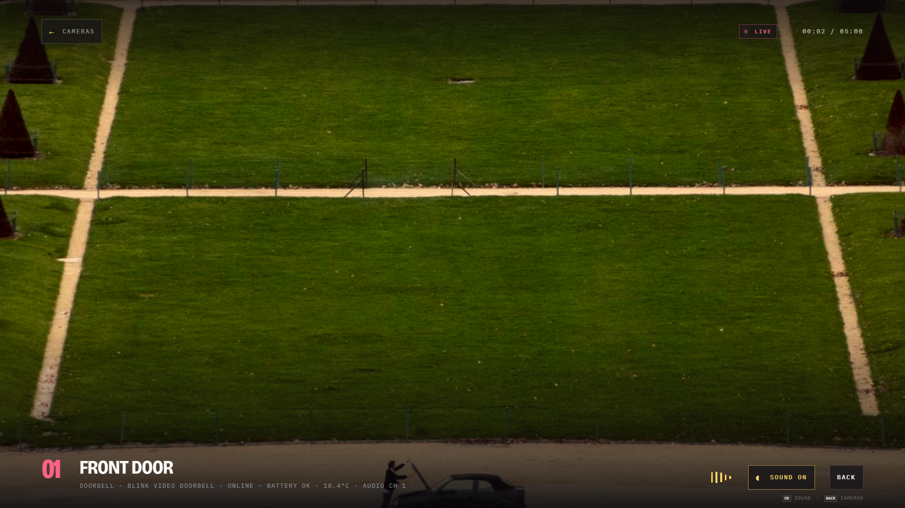
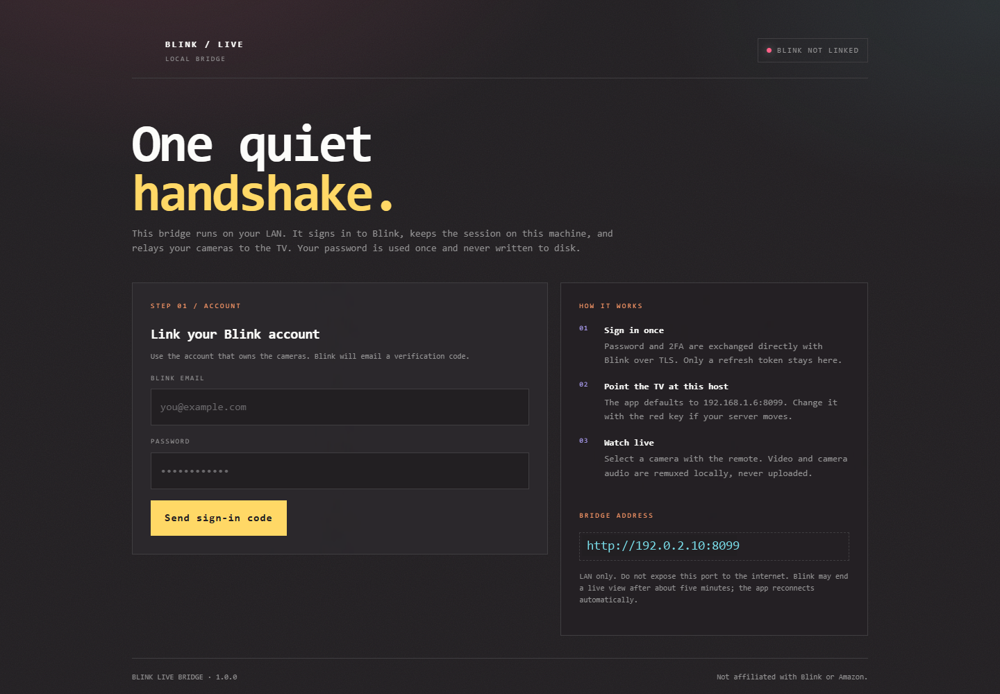

<p align="center">
  
</p>

<h1 align="center">Blink / Live</h1>

<p align="center">
  <b>Your Blink cameras. Your TV. Your LAN.</b><br>
  A Monokai Pro–styled Samsung Tizen TV dashboard for live Blink doorbell and
  outdoor camera feeds, with audio and remote-first navigation.
</p>

<p align="center">
  
  
  
  
</p>

---

Blink has no public local RTSP or ONVIF endpoint. This project does not pretend
otherwise. It uses Blink's own live-view relay (the IMMIS protocol, through
[blinkpy](https://github.com/fronzbot/blinkpy)) and keeps the rest local: account
session, remuxing, HLS, and the TV connection.

The result is a proper 10-foot interface: two camera channels, a live full-screen
view, camera audio, a remote-controlled settings screen, and no phone required
once the bridge is linked.

<p align="center">
  
</p>

## Features

- **Two-channel dashboard** with the latest Blink thumbnails, battery, signal
  and temperature status.
- **Full-screen live view** with AVPlay, the TV's native hardware decoder.
- **Camera audio** — AAC-LC, listen-only.
- **Remote-first** — arrows select, OK opens, BACK returns; RED opens settings.
- **Low-latency first path** — raw MPEG-TS over HTTP for the shortest path the
  TV will accept, with automatic HLS fallback.
- **No re-encoding** in the bridge: H.264 and AAC are copied through, preserving
  the camera's original 2K detail.
- **Five-minute Blink limit handled** — the app reconnects a fresh session.
- **30-second warm session** — reopening the same camera is nearly instant.
- **Monokai Pro palette**, bundled fonts, no external UI assets.
- **Tizen 6.0 safe** — no flex-gap dependency, no `clamp()`, no modern JS syntax
  that breaks on the 2021 Chromium 76 engine.

<p align="center">
  
</p>

## How it works

```text
Blink camera
    │  encrypted IMMIS relay (Blink cloud)
    ▼
blinkpy on the bridge
    │  raw MPEG-TS: H.264 + AAC
    ▼
┌──────────────────────────────────────────────┐
│ blink-live bridge :8099                      │
│                                              │
│  raw TS  ──────────────► AVPlay (low latency)│
│  ffmpeg -c copy ───────► HLS (fallback)      │
│  ffmpeg -c copy ───────► fMP4 over WebSocket │
│                          (browser fallback)  │
└──────────────────────────────────────────────┘
    │
    ▼
Samsung Tizen TV app
```

The TV app prefers **raw MPEG-TS + AVPlay**. Some Tizen decoders reject that
transport, so it automatically retries with **HLS + AVPlay**. A third path,
fragmented MP4 over WebSocket + MediaSource, is kept for desktop development.

### Repository map

| Path | Purpose |
|---|---|
| `backend/blink_service.py` | Blink sign-in, 2FA, session storage, camera metadata, thumbnails |
| `backend/live.py` | WebSocket/MSE live view and cleanup |
| `backend/hls.py` | HLS rendition for AVPlay fallback |
| `backend/ts.py` | Raw MPEG-TS live relay for AVPlay low-latency path |
| `backend/app.py` | HTTP/WebSocket API and pairing page |
| `backend/mp4_codec.py` | fMP4 codec discovery for MSE |
| `tizen/` | Tizen web app (plain ES5-compatible JS + CSS) |
| `tools/mock_bridge.py` | Development-only bridge and synthetic stream |
| `tests/` | Unit and end-to-end remux/lifecycle tests |

## Quick start

### 1. Run the bridge

You need Docker with Compose and a host on the same LAN as the TV.

```bash
git clone https://github.com/softstaticx/blink-tizen-security-dashboard.git
cd blink-tizen-security-dashboard
docker compose up -d --build
```

The bridge listens on port **8099**. It stores its Blink session in the
`blink-live-data` volume; no password is written to disk.

### 2. Pair Blink once

Open:

```text
http://YOUR_BRIDGE_IP:8099/setup
```

Sign in with the Blink account that owns the cameras. Blink emails a one-time
code; enter it on the same page. The bridge keeps only the refresh/access
tokens.

<p align="center">
  
</p>

### 3. Build the Tizen app

The app's bridge address is in [`tizen/config.js`](tizen/config.js). Set it to
your bridge before building, or leave it and change it on the TV later with the
**RED** key.

```js
window.BLINK_LIVE_CONFIG = {
  bridgeUrl: "http://YOUR_BRIDGE_IP:8099",
  apiToken: ""
};
```

Build a signed `.wgt` with Tizen Studio/Tizen CLI:

```powershell
.\scripts\build-wgt.ps1 -Profile BlinkLive
```

Output: `dist/BlinkLive.wgt`.

If Tizen CLI is not on `PATH`:

```powershell
.\scripts\build-wgt.ps1 `
  -TizenCli "C:\tizen-studio\tools\ide\bin\tizen.bat" `
  -Profile BlinkLive
```

Without Tizen CLI the script can create an unsigned package with `-Unsigned`,
but the TV will need Apps2Samsung or another signing path.

### 4. Install on the TV

**Apps2Samsung (recommended)**

1. Enable Developer Mode on the TV and allow the PC.
2. Open Apps2Samsung.
3. Select the TV.
4. Choose **Custom WGT**.
5. Select `dist/BlinkLive.wgt`.
6. Install and open **Blink Live**.

**Direct SDB** (Tizen Studio installed):

```powershell
.\scripts\install-tv.ps1 -Tv YOUR_TV_IP
```

The app is a standard Tizen 6.0 web widget; no root or custom firmware is
required.

## Remote controls

| Screen | Key | Action |
|---|---|---|
| Home | ← ↑ → ↓ | Select camera |
| Home | OK | Open live view |
| Home | RED | Bridge settings |
| Live | OK | Sound info / TV volume |
| Live | ← / → | Previous / next camera |
| Live | BACK | Return to the camera grid |
| Any | BACK twice | Leave the app |
| Settings | ↑ ↓ | Move between fields |
| Settings | ← → | Change audio channel when focused |

With AVPlay, audio is handled by the TV's native player; use the TV remote for
volume. The desktop MSE fallback supports in-app mute.

## Audio

Blink can expose two AAC-LC microphone tracks. The HLS fallback selects one
track (channel 1 by default). The raw TS path carries the original transport
stream; AVPlay chooses its default audio track.

If a camera has no audio, the app shows `NO AUDIO`; this is a camera/Blink
limitation.

## Latency and quality

A live view has several unavoidable parts:

1. Blink waking the battery camera (typically 3–10 s).
2. Blink's cloud relay and the camera's next H.264 keyframe.
3. The player's transport buffer.

The bridge uses `-c:v copy` and `-c:a copy`, so **quality is not reduced by the
bridge**. Probed camera feeds in testing were:

- Doorbell: 1920×1920, H.264 High@L4.0 + AAC-LC
- Outdoor: 2560×1440, H.264 High@L4.0 + AAC-LC

The raw TS path avoids HLS's one-GOP live edge. HLS remains available for
firmware that rejects chunked MPEG-TS. AVPlay is configured with a short
initial buffer, and a closed viewer keeps the session warm for 30 seconds.

The remaining delay is mostly Blink's cloud/relay and the camera's keyframe
interval. Shortening the first frame further requires transcoding to shorter
GOPs, which trades CPU and some image quality for latency.

## Configuration

| Variable | Default | Meaning |
|---|---|---|
| `PORT` | `8099` | HTTP/WebSocket port |
| `BLINK_BIND` | `0.0.0.0` | Bind address |
| `BLINK_DATA_DIR` | `/data` | Session file location |
| `BLINK_AUDIO` | `1` | Include camera audio |
| `BLINK_AUDIO_TRACK` | `0` | HLS audio track: `0` or `1` |
| `MAX_LIVE_SECONDS` | `285` | Server live-view guard; Blink stops around 5 minutes |
| `BRIDGE_TOKEN` | empty | Optional shared token for every API call except health |
| `LOG_LEVEL` | `INFO` | Python log level |
| `TZ` | `Europe/Copenhagen` | Container timezone |

The TV app stores `bridge`, `token` and `audioTrack` in `localStorage`.

### Optional bridge token

If the LAN is shared, set a long random `BRIDGE_TOKEN` in Compose and enter the
same value in the TV settings. HLS/TS media routes are exempt because AVPlay
cannot send custom headers; the session IDs are unguessable and LAN-only.

## Security and privacy

- **LAN only.** Do not port-forward the bridge. There is no separate login on
  the pairing page; anyone who can reach it could unlink the account.
- **Placeholders in this repo.** `YOUR_BRIDGE_IP`, `YOUR_TV_IP` and
  `192.0.2.10` are documentation addresses. No real account credentials or
  network details are included.
- **Password is used once.** The bridge stores only Blink refresh/access tokens
  in `/data/blink_session.json`; protect that volume.
- **No third-party video service.** The camera stream still traverses Blink's
  cloud relay, as it does in the Blink phone app. This project does not upload
  footage anywhere else.
- **No recording.** The bridge relays; it does not save clips.
- **Listen-only audio.** Two-way talk is not implemented.
- **Unofficial API.** Blink can change its API or live-view client checks at any
  time. This is not affiliated with Blink or Amazon.

## Troubleshooting

### TV says “BRIDGE OFFLINE”

- From a PC: `curl http://YOUR_BRIDGE_IP:8099/api/health`
- On the bridge host: `docker logs --tail 100 blink-live`
- Confirm the TV and bridge are on the same VLAN and client isolation is off.
- Press **RED** on the TV and check the bridge URL.

### “LINK YOUR BLINK ACCOUNT” does not advance

- Open `/setup` and complete the 2FA step.
- Check `/api/health` for `"blink":{"state":"ready"}`.
- If the session expired, sign in again; the password is not stored.

### No picture

- Confirm the camera is online in the Blink app.
- Close any live view on the phone; Blink allows one live view at a time.
- Check `docker logs -f blink-live` for `ffmpeg`/relay errors.
- If raw TS was rejected, the app should fall back to HLS automatically. A
  brief “AVPLAY” loader followed by a working picture is normal.

### No audio

- AVPlay uses the TV volume; the app's button is informational.
- In the HLS fallback, try **RED → Camera audio channel → Channel 2**.
- `NO AUDIO` means the camera exposed no AAC track.

### Live view stops after about five minutes

This is Blink's limit. The app reconnects automatically. On battery cameras,
each reconnect wakes the camera again.

### Tizen install errors

| Error | Meaning |
|---|---|
| `[118, -19] Parsing error` | Tizen package/app id must use the 10-character package rule (`BlinkLive1.Security` here). |
| `[118, -4]` / certificate error | Use a distributor certificate covering this TV; in Apps2Samsung use Partner signing if prompted. |
| `install failed[118]` | TV storage, developer mode, or host-PC permission issue. Reconnect with SDB and retry. |

## Development

```powershell
python -m venv .venv
.\.venv\Scripts\python.exe -m pip install -r backend\requirements.txt
.\.venv\Scripts\python.exe -m unittest discover -s tests -v
```

Run the mock bridge — no Blink account and no TV required:

```powershell
.\scripts\dev.ps1
```

Then open <http://127.0.0.1:8098/app/>. The mock generates test frames and a
synthetic fMP4 stream through the same media pipeline.

Tests cover H.264/AAC discovery, real MPEG-TS → fMP4 remuxing with and without
audio, watchdog/idle cleanup, API/WebSocket origin checks, and the setup surface.

## Credits

Standing on the work of the Blink reverse-engineering community:

- [blinkpy](https://github.com/fronzbot/blinkpy) (MIT) — Blink API and IMMIS relay.
- [blink2video](https://github.com/nico579/blink2video) (GPL-3.0) — live-view,
  audio and ffmpeg pipeline research that informed this implementation.
- [blink-liveview-middleware](https://github.com/amattu2/blink-liveview-middleware)
  and [immi2mpeg](https://github.com/Wilkware/immi2mpeg) — protocol documentation.
- [Apps2Samsung](https://github.com/Apps2Samsung/Apps2Samsung) — Tizen install path.
- Monokai Pro by Wimer Hazenberg for the palette.

Licensed under **GPL-3.0**. See [`LICENSE`](LICENSE) and [`NOTICE.md`](NOTICE.md).
Not affiliated with Blink, Amazon, Samsung or Tizen.
